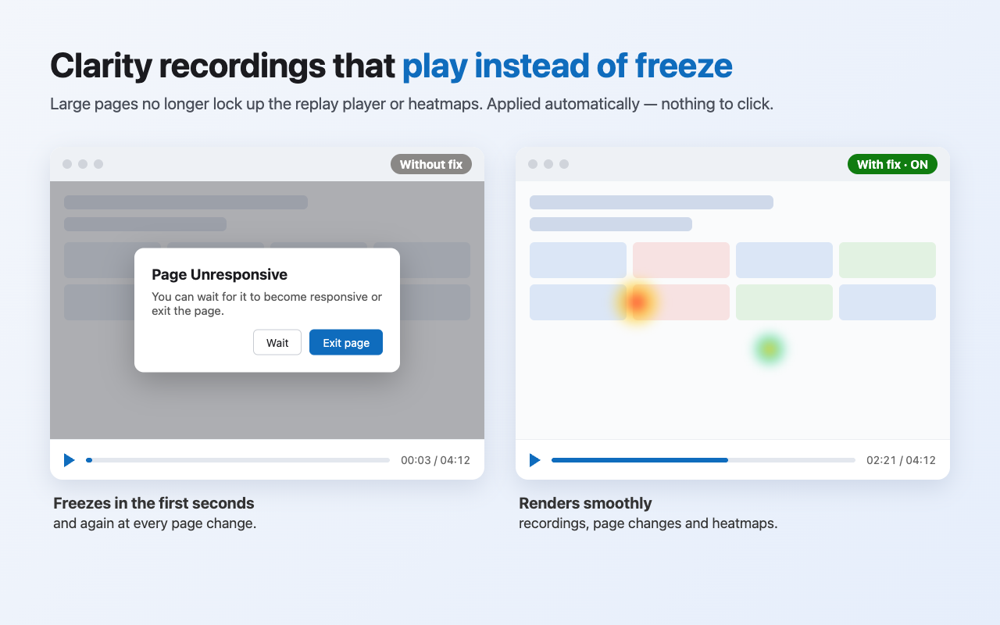
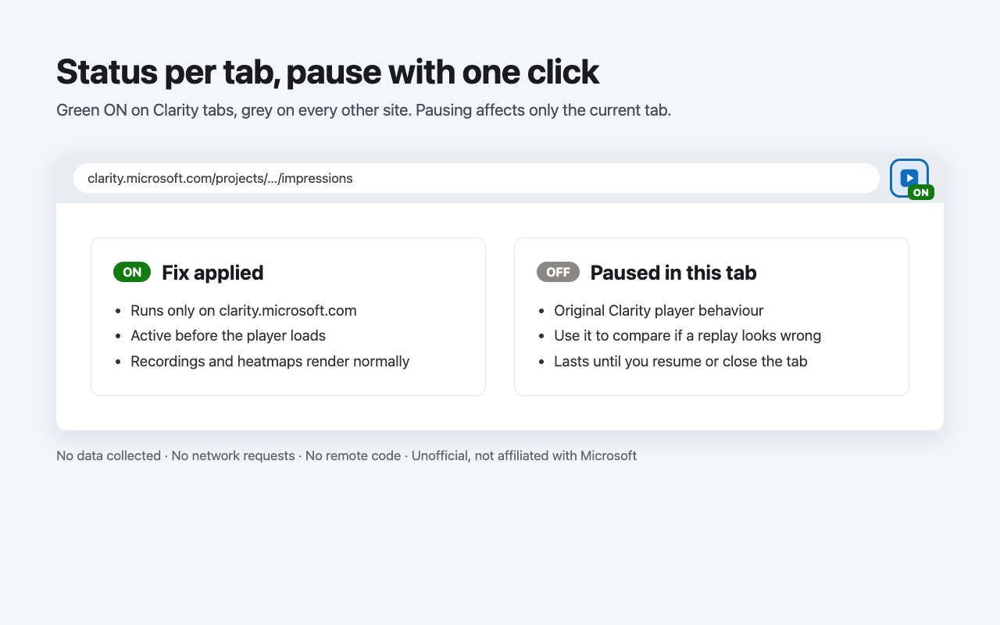

# Replay Fix for Microsoft Clarity

Unofficial Chrome extension that stops Microsoft Clarity session recordings and heatmaps from freezing ("Page Unresponsive") when the recorded website is large.

> Not affiliated with, endorsed by, or produced by Microsoft. "Microsoft Clarity" is a trademark of Microsoft Corporation.



## The problem

On sites with tens of thousands of DOM elements and large stylesheets, opening a Clarity recording or heatmap can freeze the browser tab within the first few seconds, and again whenever the recording reaches a page change.

## The cause

While rebuilding the recorded page, the Clarity replay renderer ([`clarity-visualize`](https://github.com/microsoft/clarity/tree/master/packages/clarity-visualize), `layout.ts`, `mask()`) calls `window.getComputedStyle()` on every inserted `DIV`, `SPAN`, `P`, `SECTION` and similar element, to look for background images inside masked regions:

```ts
private mask = (node: HTMLElement) => {
    if (node && this.BackgroundImageEligibleElements.includes(node.nodeName) && 'getComputedStyle' in window && 'closest' in node) {
        const computedStyles = window.getComputedStyle(node);          // forces a full style recalculation
        const hasBackgroundImage = computedStyles.backgroundImage?.match(urlPattern) || ...;
        const masked = node.closest?.(`[${LayoutConstants.MaskData}]`); // cheap check, done second
        if (hasBackgroundImage && masked) { ... }
    }
};
```

Each node was just inserted, so styles are dirty and every call forces the browser to recalculate styles for the whole replayed document. As the page grows, each step gets slower. In our measurements the renderer slowed from about 200 to about 140 elements per second while building a ~20,000-element page, with one `getComputedStyle` call for almost every element created, so the tab stayed frozen for minutes.

An upstream fix would be to check `closest('[data-clarity-mask]')` **before** calling `getComputedStyle`.

## What this extension does

It wraps `window.getComputedStyle` on `clarity.microsoft.com` only. For elements that belong to the replayed page (not Clarity's own UI) and are **not** inside a `[data-clarity-mask]` region, it returns an empty style object, so `mask()` skips its work. Masked regions still get the real computed style.

- Runs only on `https://clarity.microsoft.com/*`, at `document_start`, before the player loads
- Works for recordings, page changes inside a recording, and heatmaps
- Collects no data, makes no network requests, loads no remote code

## Toolbar button (per tab)



| Current tab | Button |
|---|---|
| Not Clarity | Grey, disabled |
| Clarity | Blue, green **ON** (fix applied automatically) |
| Clarity, paused | Blue, grey **OFF** |

Click the button on a Clarity tab to pause or resume the fix **for that tab only**. The tab reloads. The pause lasts until you resume it or close the tab; other tabs are not affected.

## Install from source

1. Download or clone this repository
2. Open `chrome://extensions` and turn on **Developer mode**
3. Click **Load unpacked** and select the `extension` folder
4. Optional: to use it in Incognito, open the extension's **Details** and enable **Allow in Incognito**

## Privacy

See [PRIVACY.md](PRIVACY.md). In short: no data is collected, stored remotely, or shared.

## Notes

- This is a temporary workaround. Once the replay renderer is fixed upstream, you can remove the extension.
- If a replay ever looks wrong, pause the fix in that tab to compare, and please open an issue.
